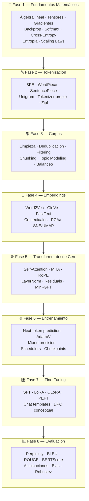
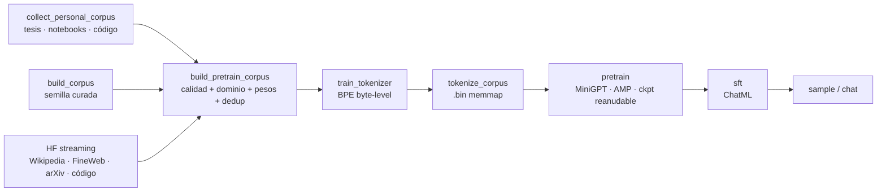

# 🧠 LLM Lab — Laboratorio de Construcción y Entrenamiento de LLMs desde Cero

> **Etapa 1** — Fundamentos, tokenización, corpus, embeddings, transformers, entrenamiento, fine-tuning y evaluación.
> Un laboratorio **educacional + industrial** para entender completamente cómo se construye y entrena un LLM moderno, especializado en estadística, optimización y metaheurísticas, ciencia de datos y analítica, IA y LLMs, desarrollo full stack, filosofía y música, sobre una base de ML/DL, matemáticas y el stack de software y datos.

---

## 🎯 Objetivo

Este proyecto **NO** es un wrapper de APIs existentes. Es un laboratorio de investigación personal, al estilo de los cursos y repositorios de Stanford (CS224N/CS324), Berkeley, Karpathy (nanoGPT/minGPT), HuggingFace Research y los blogs técnicos de Anthropic/OpenAI/DeepMind, cuyo propósito es:

- **Entender** la matemática completa detrás de un LLM: álgebra lineal, gradientes, backpropagation, entropía, scaling laws.
- **Construir** cada componente desde cero: tokenizador, embeddings, attention, transformer decoder-only.
- **Entrenar** modelos pequeños especializados en 26 dominios (técnicos + filosofía y música).
- **Visualizar** internamente: attention maps, gradient flow, evolución de pesos, activaciones, espacios de embeddings.
- **Evaluar** con rigor: perplexity, BLEU/ROUGE/BERTScore, alucinaciones, sesgo, robustez.
- **Experimentar** con arquitecturas modernas: RoPE, GQA, Flash Attention, MoE (conceptual).

## 🗺️ Mapa del Proyecto



## 📁 Estructura

```
llm-lab/
├── .devcontainer.json    # devcontainer (VS Code → Reopen in Container)
├── .docker/              # Dockerfile multi-stage (img-dev CPU / img-gpu CUDA) + compose
├── .envs/                # variables (HF_TOKEN); solo *.example se versiona
├── Makefile              # atajos del pipeline: make help
├── notebooks/            # 00–08 educativos + 09 runner Colab/Kaggle
├── src/llm_lab/          # Paquete Python reutilizable (espejo del código de los notebooks)
│   ├── utils/            #   seeds, logging, detección de hardware, configs
│   ├── data/             #   limpieza, dedup, chunking, dominios, fuentes HF, loader memmap
│   ├── tokenization/     #   BPE desde cero + wrappers de HF tokenizers
│   ├── embeddings/       #   Word2Vec desde cero, proyecciones, similitud
│   ├── model/            #   transformer decoder-only desde cero (mini-GPT)
│   ├── training/         #   loops de entrenamiento, schedulers, checkpointing
│   ├── finetuning/       #   SFT, LoRA, chat templates
│   ├── evaluation/       #   perplexity, BLEU/ROUGE, benchmarks
│   └── visualization/    #   attention maps, gradient flow, dashboards
├── scripts/              # pipeline: personal → corpus → tokenizer → .bin → pretrain → sft → sample
├── datasets/             # raw/ (seed, personal) processed/ splits/ sft/ pretrain/ tokenized/
├── tokenizer/            # tokenizadores entrenados
├── embeddings/           # embeddings entrenados
├── configs/              # base + perfiles tiny/small/large, data (mezcla), domains (léxico), personal
├── docs/                 # documentación profunda + bibliografía por dominio
├── research/             # notas de investigación, papers anotados
├── experiments/          # registros de experimentos
├── synthetic_data/       # generación conceptual de datos sintéticos
├── checkpoints/          # pesos de modelos (no versionados)
├── logs/                 # logs estructurados (no versionados)
└── outputs/              # artefactos generados (no versionados)
```

## 📓 Notebooks

| # | Notebook | Contenido | Estado |
|---|----------|-----------|--------|
| 00 | `00_setup_y_hardware.ipynb` | Setup Colab, detección GPU, seeds, limitaciones | ✅ |
| 01 | `01_fundamentos_matematicos.ipynb` | Historia LLMs, álgebra lineal, tensores, backprop, softmax, cross-entropy, entropía, scaling laws | ✅ |
| 02 | `02_tokenizacion.ipynb` | BPE/WordPiece/SentencePiece/Unigram desde cero, tokenizer propio, ley de Zipf | ✅ |
| 03 | `03_construccion_corpus.ipynb` | Limpieza, dedup (MinHash), filtering, chunking semántico, topic modeling, balanceo de dominios | ✅ |
| 04 | `04_embeddings.ipynb` | Word2Vec/GloVe/FastText, embeddings contextuales, PCA/t-SNE/UMAP, aritmética vectorial | ✅ |
| 05 | `05_transformer_desde_cero.ipynb` | Self-attention, MHA, RoPE, causal masking, KV cache, GQA, Flash Attention, MoE, mini-GPT completo | ✅ |
| 06 | `06_entrenamiento.ipynb` | Loop de entrenamiento, AdamW/Lion, mixed precision, gradient accumulation, schedulers, monitoreo GPU | ✅ |
| 07 | `07_finetuning.ipynb` | SFT, LoRA/QLoRA desde cero y con PEFT, chat templates, RLHF/DPO conceptual | ✅ |
| 08 | `08_evaluacion.ipynb` | Perplexity, BLEU, ROUGE, BERTScore, alucinaciones, toxicidad, bias, robustez | ✅ |
| 09 | `09_entrenamiento_colab_kaggle.ipynb` | Runner: pre-entrenamiento + SFT de tu modelo en Colab/Kaggle, reanudable | ✅ |

## 🧭 Dos formas de usar el laboratorio

| | Notebooks educativos `00`–`08` | Pipeline de entrenamiento (`scripts/` + `src/llm_lab/`) |
|---|---|---|
| Para qué | **Aprender** cada pieza | **Entrenar tu modelo** |
| Código | Autocontenido en celdas (no importa `src/`) | Scripts que usan el paquete `src/llm_lab` (con tests) |
| Datos | Demos y ejemplos inline | Corpus personal + semilla + Hugging Face filtrado por 26 dominios |
| Modelo | Didáctico: SMALL ~5 M / LARGE ~110 M | `tiny` ~0.9 M · `small` ~17 M · `large` ~101 M |
| Dónde | Jupyter en el contenedor o Colab | Datos y `tiny` en el contenedor del Mac; `small`/`large` en GPU (Docker en host NVIDIA, o Colab/Kaggle vía notebook 09) |

**Todo corre en Docker o en la nube; nada se instala en el sistema local.** Paso a paso completo (contenedor,
smoke test, datos, entrenamiento en GPU, Colab/Kaggle): **[docs/06 · Guía de ejecución](docs/06_guia_ejecucion.md)**.

### Inicio rápido (contenedor)

```bash
cd llm-lab
cp .envs/hf.env.example .envs/hf.env                         # HF_TOKEN opcional
docker compose -f .docker/docker-compose.yml up -d --build   # o VS Code → "Reopen in Container"
docker exec -it LLMLab bash
.docker/entrypoint.sh && make test && make smoke             # dentro del contenedor
```

### Pipeline de entrenamiento



| Perfil | Hardware | Parámetros | Tokens |
|---|---|---|---|
| `tiny` | CPU (contenedor en el Mac) | ~0.9 M | corpus local (smoke test) |
| `small` | T4 16 GB | ~17 M | ~350 M |
| `large` | A100 / L4 / RTX 4090 | ~101 M | ~2 B |

Corpus, plataformas (Colab vs Kaggle vs RunPod), buenas prácticas y experimentos guiados:
[docs/07 · Entrenamiento práctico](docs/07_entrenamiento_practico.md).

### Docker

Estructura: `.devcontainer.json` + `.docker/{Dockerfile,docker-compose.yml,entrypoint.sh,git.sh}` + `.envs/`.

- `img-dev` (CPU, contenedor `LLMLab`): datos, tokenizador, tests, notebooks y smoke test. Monta
  la carpeta padre del repo (tus documentos personales, `PERSONAL_ROOT`) en `/personal` (solo lectura) y expone JupyterLab en el puerto 8888.
- `img-gpu` (CUDA): para hosts con GPU NVIDIA (VM con Docker o RunPod).
- Extras pesados de los notebooks: opcionales con `WITH_NOTEBOOKS: 'true'` en `build.args` del compose.

## 🧪 Reproducibilidad

- **Seeds** (`seed: 42` en `configs/base.yaml`) fijadas en Python, NumPy, PyTorch y CUDA — `src/llm_lab/utils/seed.py`.
- **Configs YAML en capas** en `configs/` (`base` ← `tiny`/`small`/`large`; `data`, `domains`, `corpus`, `personal`).
- **Métricas en JSONL** en `<carpeta del run>/logs/` (se reconstruyen las curvas con pandas).
- **Checkpoints reanudables**: modelo + optimizador + scheduler + GradScaler + RNG + estado del DataLoader.

## 📚 Documentación

| Documento | Contenido |
|-----------|-----------|
| [docs/00_vision_general.md](docs/00_vision_general.md) | Visión, filosofía y alcance de la Etapa 1 |
| [docs/01_roadmap.md](docs/01_roadmap.md) | Roadmap detallado Etapa 1 → Etapa 2 |
| [docs/02_libros_y_fuentes.md](docs/02_libros_y_fuentes.md) | Bibliografía de referencia por dominio + fuentes que de verdad usa el corpus |
| [docs/03_arquitectura.md](docs/03_arquitectura.md) | Arquitectura del proyecto y decisiones de diseño |
| [docs/04_esquema_corpus.md](docs/04_esquema_corpus.md) | Formatos del corpus (semilla, pre-entrenamiento, tokenizado), weighting y splits |
| [docs/05_colab_y_hardware.md](docs/05_colab_y_hardware.md) | GPUs de Colab, límites, presupuesto de VRAM |
| [docs/06_guia_ejecucion.md](docs/06_guia_ejecucion.md) | **Paso a paso**: notebooks vs pipeline, contenedor, smoke test, datos, GPU con Docker, Colab/Kaggle, problemas frecuentes |
| [docs/07_entrenamiento_practico.md](docs/07_entrenamiento_practico.md) | Qué se entrena y con qué corpus, plataformas y costos, buenas prácticas, experimentos guiados |

## 🔭 Etapa 2 (futura — fuera de alcance aquí)

Agentes, RAG, serving, APIs de producción, deployment, MLOps, observabilidad, sistemas multiagente, tool calling, memoria y workflows autónomos.

---

**Autor:** Sebastian Torres · Ingeniero Electricista & ML Engineer
**Licencia:** MIT (declarada en `pyproject.toml`; aún no hay archivo `LICENSE`)
