# Roadmap — LLM Lab

## Etapa 1 — Fundamentos y entrenamiento (este repo)

```mermaid
gantt
    title Etapa 1 — Orden recomendado de estudio
    dateFormat X
    axisFormat %s
    section Fundamentos
        F1 Matemáticas           :f1, 0, 3
        F2 Tokenización          :f2, after f1, 2
    section Datos
        F3 Corpus                :f3, after f2, 3
        F4 Embeddings            :f4, after f3, 2
    section Modelo
        F5 Transformer           :f5, after f4, 4
        F6 Entrenamiento         :f6, after f5, 3
    section Especialización
        F7 Fine-tuning           :f7, after f6, 2
        F8 Evaluación            :f8, after f7, 2
```

### Hitos por fase

| Fase | Hito verificable |
|------|------------------|
| F1 | Implementar backprop a mano para una red de 2 capas y verificar gradientes numéricamente (`grad_check < 1e-6`) |
| F2 | Tokenizador BPE propio entrenado sobre corpus técnico, comparado contra GPT-2/Llama en compresión (tokens/palabra) |
| F3 | Corpus v1: ≥ 5 000 documentos limpios, deduplicados, balanceados por dominio, en JSONL + Parquet |
| F4 | Word2Vec desde cero con analogías funcionando (`rey - hombre + mujer ≈ reina`; `voltaje/corriente ≈ presión/caudal`) |
| F5 | Mini-GPT desde cero que sobreajusta un batch (loss → 0) — la prueba canónica de que el modelo y el loop son correctos |
| F6 | Pre-entrenamiento SMALL completo con curvas de loss/perplexity y checkpoints reanudables |
| F7 | Modelo base fine-tuneado con LoRA sobre dataset instruccional propio, comparación before/after |
| F8 | Reporte de evaluación: perplexity por dominio + BLEU/ROUGE/BERTScore + análisis de alucinaciones |

## Etapa 2 — Sistemas (repo futuro, NO en este)

RAG sobre el corpus técnico → serving (vLLM/TGI) → API con FastAPI → deployment AWS (el stack serverless que Sebastian ya domina) → observabilidad → agentes y tool calling → multiagente.

La Etapa 2 reutilizará: el corpus (F3), el tokenizador (F2), los modelos fine-tuneados (F7) y el framework de evaluación (F8).
