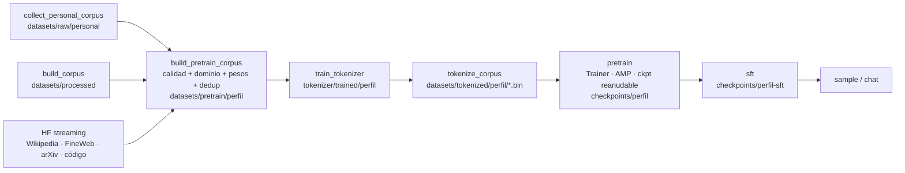

# Arquitectura del Proyecto

## Decisiones de diseño

| # | Decisión | Alternativas consideradas | Justificación |
|---|----------|---------------------------|---------------|
| 1 | Notebooks **autocontenidos** (cada uno instala deps y define su código) | Notebooks que importan todo de `src/` | Se pueden abrir en Colab sin el resto del repo. `src/llm_lab` es la versión limpia y testeada que usa el pipeline de `scripts/`; los notebooks 00–08 no lo importan. |
| 2 | Arquitectura **decoder-only** (GPT) | Encoder-only (BERT), encoder-decoder (T5) | Es la arquitectura de todos los LLMs modernos (GPT-4, Llama, Qwen, Claude). BERT y T5 se estudian comparativamente en F1. |
| 3 | **RoPE** como positional encoding por defecto | Learned absolute, sinusoidal | Estándar moderno (Llama, Qwen); sinusoidal y learned se implementan también en F5 para comparar. |
| 4 | Configs **YAML en capas** (base ← perfil ← overrides) | Hydra, OmegaConf, argparse | Cero dependencias extra, legible, suficiente para Etapa 1. |
| 5 | Métricas en **JSONL** + matplotlib | TensorBoard, W&B | Sin servicios externos; las curvas se reconstruyen con pandas. W&B queda para Etapa 2. |
| 6 | Tokenizador propio con **BPE byte-level** | SentencePiece Unigram | Mismo algoritmo que GPT-2/Llama; se entrena con la librería `tokenizers` (Rust) tras implementarlo desde cero en Python. |
| 7 | Perfiles por hardware | Un solo tamaño | Pipeline: `tiny`/`small`/`large` en `configs/`. Notebooks: SMALL/LARGE didácticos, elegidos por VRAM en su celda de setup (código inline equivalente a `llm_lab.utils.hardware`). |
| 8 | Corpus **bilingüe** (es/en) | Solo inglés | La documentación técnica está en inglés; el razonamiento del usuario es en español. El tokenizador debe cubrir ambos. |
| 9 | Todo en **Docker** | venv local | Mismo entorno en el Mac (`img-dev`, CPU) y en hosts GPU (`img-gpu`); nada se instala en el sistema. |
| 10 | Datos tokenizados en **memmap `.bin`** por fuente | Arrow / dataset en RAM | Lectura O(1) por ventana, sin cargar el corpus en memoria; la mezcla se pondera al muestrear (re-balancear no exige re-tokenizar). |

## Flujo de datos del pipeline



## Estructura del paquete `src/llm_lab`

```
src/llm_lab/
├── pipeline.py          # rutas por perfil, carga de configs y GPTConfig (lo usan los scripts)
├── utils/
│   ├── seed.py          # set_seed() — Python/NumPy/Torch/CUDA
│   ├── hardware.py      # detect_hardware(), get_device(), gpu_memory_snapshot()
│   ├── logging.py       # get_logger(), MetricsLogger (JSONL)
│   └── config.py        # load_config() — YAML en capas
├── data/                # Fase 3: limpieza, dedup, chunking, schema, pesos,
│                        #   domains.py (léxico), sources.py (HF/local), loader.py (memmap)
├── tokenization/        # Fase 2: BPE desde cero + wrapper de `tokenizers`
├── embeddings/          # Fase 4: Word2Vec (skip-gram) desde cero, proyecciones
├── model/               # Fase 5: attention, bloque transformer, MiniGPT
├── training/            # Fase 6: Trainer, schedulers, checkpointing
├── finetuning/          # Fase 7: LoRA desde cero, chat templates, SFT
├── evaluation/          # Fase 8: perplexity, generación, métricas de texto
├── visualization/       # attention maps, gradient flow, curvas
└── tests/               # test_smoke.py, test_pipeline.py (make test)
```

**Regla de dependencia:** `utils` no importa de nadie; cada subpaquete importa solo de `utils` y de sí mismo; `pipeline.py` (orquestación) importa de `utils` y `model`. Los notebooks no importan `src/` y `src/` nunca depende de notebooks.

## Convención de checkpoints

`scripts/pretrain.py` escribe en la carpeta del run (`checkpoints/<perfil>/` o `--out_dir`):

| Archivo | Cuándo | Para qué |
|---|---|---|
| `last.pt` | cada `checkpoint_every_steps` y al final | reanudar (se carga solo al relanzar) |
| `best.pt` | cuando mejora `val_loss` | inferencia, SFT |
| `tokenizer.json`, `model_config.json` | al inicio | que la carpeta sea autocontenida (`sample.py`, `sft.py`) |
| `logs/metrics_<perfil>.jsonl` | cada `log_every_steps` / eval | curvas con pandas |

Contenido de `last.pt` / `best.pt`:

```python
{
  "step": int,
  "model_state_dict": ...,
  "optimizer_state_dict": ...,
  "scheduler_state_dict": ...,     # {"step_num": int}
  "scaler_state_dict": ...,        # GradScaler (activo solo en fp16)
  "rng_state": {python, numpy, torch, cuda},
  "data_state": {"rng": ...},      # estado del muestreador de TokenDataset
  "config": {"model": ..., "train": ...},
  "metrics": {"best_val": float, ...},
}
```

Los checkpoints de `sft.py` guardan solo `model_state_dict` y `step`.
