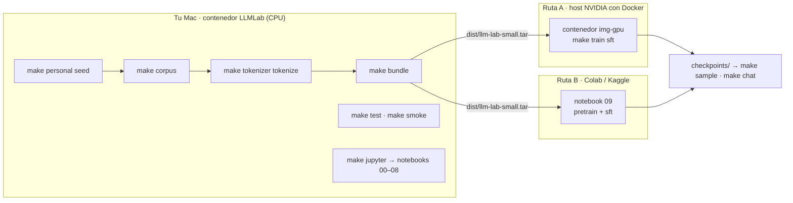

# 06 · Guía de ejecución (paso a paso)

Esta es **la** guía para ejecutar el laboratorio. Regla del proyecto: **nada se instala ni se entrena en
el sistema local**. Todo corre en un contenedor Docker (en tu Mac o en una máquina con GPU) o en un
entorno gestionado en la nube (Colab / Kaggle).

---

## 1. Notebooks vs. pipeline: qué es cada cosa

El repositorio tiene **dos productos distintos** que comparten tema pero no código en tiempo de ejecución:

| | Notebooks educativos `00`–`08` | Pipeline de entrenamiento (`scripts/` + `src/llm_lab/`) |
|---|---|---|
| **Para qué** | Aprender cada pieza: matemática, tokenización, atención, entrenamiento, LoRA, evaluación | Entrenar **tu** modelo de verdad |
| **Código** | Autocontenido: cada notebook re-implementa su código en celdas. **No importa** `src/llm_lab` | Los scripts importan el paquete `src/llm_lab` (código limpio y con tests) |
| **Datos** | Demos sintéticas o textos de ejemplo escritos en el notebook | Corpus real: tu corpus personal + corpus semilla + fuentes públicas de Hugging Face filtradas por dominio |
| **Tamaño del modelo** | Perfiles didácticos propios: SMALL ~5 M / LARGE ~110 M parámetros (≈85 M sin embeddings) | Perfiles de `configs/`: `tiny` ~0.9 M · `small` ~17 M · `large` ~101 M |
| **Resultado** | Gráficas, verificaciones, intuición. Checkpoints de demostración | Tokenizador propio, checkpoints reanudables, modelo SFT, chat |
| **Dónde corre** | Jupyter en el contenedor (CPU) o Colab | Datos y `tiny`: contenedor en el Mac. `small`/`large`: GPU (Docker en un host NVIDIA, o Colab/Kaggle) |

Relación entre ambos: `src/llm_lab` es la versión limpia y testeada de lo que enseñan los notebooks
(mismo MiniGPT, mismo BPE, mismo Trainer). Si cambias algo en un notebook, **no** afecta al pipeline.

El **notebook `09_entrenamiento_colab_kaggle`** no enseña nada: es solo un *lanzador* que ejecuta los
scripts del pipeline dentro de Colab o Kaggle.



**¿Por qué no se entrena `small` en el Mac?** Docker en macOS no expone la GPU de Apple (MPS) ni hay GPU
NVIDIA: el contenedor solo usa CPU. Sirve para preparar datos (usa todos los núcleos), tests, notebooks y
el smoke test `tiny`; entrenar `small` en CPU tomaría días.

---

## 2. Preparar el contenedor (una sola vez)

**Requisitos:** Docker Desktop con ≥ 8 GB de RAM asignada (Settings → Resources) y **≥ 30 GB libres en
disco** (imagen + caché de Hugging Face + datos de `small`). Revisa el espacio con `docker system df`.

```bash
cd ~/repositorio-personal/llm
cp .envs/hf.env.example .envs/hf.env      # pega tu HF_TOKEN (lectura); opcional, evita límites de descarga
```

Abre el contenedor **de una de estas dos formas**:

- **VS Code:** paleta → *Dev Containers: Reopen in Container*. Ejecuta el `entrypoint.sh` automáticamente.
- **Terminal:**
  ```bash
  docker compose -f .docker/docker-compose.yml up -d --build   # construye la imagen img-dev (la primera vez tarda)
  docker exec -it LLMLab bash                                  # entra al contenedor
  .docker/entrypoint.sh                                        # solo la primera vez: git + pip install -e .
  ```

Dentro del contenedor estás en `/app` (= la carpeta `llm/` del Mac, montada). Tu carpeta
`repositorio-personal` está montada en `/personal` **solo lectura**, como fuente del corpus personal.

```bash
make help        # lista todos los comandos
make test        # tests del paquete (deben pasar antes de seguir)
```

A partir de aquí, **todos los comandos `make …` se ejecutan dentro del contenedor**.

---

## 3. Ruta Docker

### 3.1 Smoke test con `tiny` (en el Mac, minutos)

```bash
make smoke
```

Ejecuta el pipeline completo en pequeño, solo con fuentes locales (sin descargar nada):

| Paso | Comando interno | Produce |
|---|---|---|
| Corpus personal | `scripts/collect_personal_corpus.py` | `datasets/raw/personal/personal.jsonl` (secretos y correos redactados) |
| Corpus semilla + SFT | `scripts/build_corpus.py`, `scripts/build_sft.py` | `datasets/processed/`, `datasets/sft/` |
| Corpus del perfil | `scripts/build_pretrain_corpus.py --profile tiny` | `datasets/pretrain/tiny/` |
| Tokenizador | `scripts/train_tokenizer.py` | `tokenizer/trained/tiny/tokenizer.json` |
| Tokenización | `scripts/tokenize_corpus.py` | `datasets/tokenized/tiny/*.bin` + `meta.json` |
| Pre-entrenamiento | `scripts/pretrain.py --profile tiny` (300 pasos) | `checkpoints/tiny/{last,best}.pt` + `logs/` |
| SFT + muestra | `scripts/sft.py`, `scripts/sample.py` | `checkpoints/tiny-sft/` y texto generado |

Qué esperar: la loss empieza cerca de ln(4096) ≈ 8.3 y baja; el texto generado será torpe (el modelo
tiene <1 M de parámetros). El objetivo es que **nada falle** antes de gastar GPU.

### 3.2 Preparar los datos de `small` (en el Mac)

```bash
make personal seed                          # corpus personal + semilla (rápido)
make corpus PROFILE=small WORKERS=10        # descarga en streaming y filtra ~350 M tokens (horas, depende de la red)
make tokenizer tokenize PROFILE=small       # BPE de 16k + archivos .bin
make bundle PROFILE=small                   # → dist/llm-lab-small.tar
```

- `make corpus` es **reanudable**: cada fuente terminada deja un `.done`; si se corta, vuelve a correrlo.
- Antes de empaquetar, revisa `datasets/pretrain/small/manifest.json` (documentos y tokens por fuente) y
  `datasets/tokenized/small/meta.json` (mezcla por dominio).
- El `.tar` lleva **código + `.docker/` + tokenizador + datos tokenizados**: es todo lo que necesita la
  máquina con GPU. Contiene tokens de tu corpus personal: **mantenlo privado**.

### 3.3 Entrenar en un host con GPU NVIDIA usando Docker

Sirve cualquier máquina Linux con GPU NVIDIA, Docker y `nvidia-container-toolkit` (una VM en
Lambda/Vast.ai/GCP/AWS o un servidor propio).

**1) Llevar el bundle al host.** Lo más simple es un dataset **privado** de Hugging Face:

```bash
# En el contenedor del Mac
huggingface-cli upload <tu-usuario>/llm-lab-data dist/llm-lab-small.tar --repo-type dataset --private

# En el host con GPU (con HF_TOKEN exportado)
pip install -U huggingface_hub
huggingface-cli download <tu-usuario>/llm-lab-data llm-lab-small.tar --repo-type dataset --local-dir .
```

(Alternativa: `scp dist/llm-lab-small.tar usuario@host:~`.) En versiones recientes de `huggingface_hub`
el comando también se llama `hf upload` / `hf download`.

**2) Construir la imagen GPU y entrenar:**

```bash
mkdir -p llm && tar -xf llm-lab-small.tar -C llm && cd llm
docker build -f .docker/Dockerfile --target img-gpu -t llm-lab:gpu .
docker run -d --name LLMLabGPU --gpus all --shm-size 8g \
    -u "$(id -u):$(id -g)" -e HOME=/tmp -v "$PWD":/app llm-lab:gpu
docker exec -it LLMLabGPU bash -c "nvidia-smi && make train sft PROFILE=small"
```

- `-u $(id -u):$(id -g)` hace que los checkpoints queden con tu usuario del host (evita problemas de permisos).
- Usa `tmux` (o `docker exec -d`) para que el entrenamiento siga si se cae tu conexión SSH.
- `make train` **reanuda solo** si existe `checkpoints/small/last.pt`. Para empezar de cero:
  `python scripts/pretrain.py --profile small --fresh`.
- Para `large`: igual, con `PROFILE=large` y un bundle de `large` (requiere ≥ 24 GB de VRAM).

**Variante RunPod** (los pods ya son contenedores, no se puede usar `docker` dentro): publica la imagen y
úsala como imagen del pod.

```bash
# En el Mac (fuera o dentro del contenedor, necesita Docker y una cuenta de Docker Hub)
docker buildx build --platform linux/amd64 -f .docker/Dockerfile --target img-gpu \
    -t <usuario-dockerhub>/llm-lab:gpu --push .
```

En RunPod: *Deploy* → imagen `<usuario-dockerhub>/llm-lab:gpu`, volumen en `/workspace`, variable
`HF_TOKEN`. En la terminal del pod: descarga el bundle (paso 1) en `/workspace`, `tar -xf` en
`/workspace/llm`, `cd /workspace/llm && make train sft PROFILE=small`.

**3) Traer el modelo de vuelta al Mac:** copia `checkpoints/small/` y `checkpoints/small-sft/` a
`llm/checkpoints/` (con `scp` o subiéndolos al mismo dataset privado de HF). La inferencia corre bien en CPU:

```bash
make sample PROFILE=small                # completar texto
make chat   PROFILE=small                # chat con el modelo tras SFT
```

---

## 4. Ruta Colab / Kaggle (sin Docker propio)

Colab y Kaggle ya son contenedores gestionados con GPU; ahí no se usa nuestra imagen, sino el notebook
lanzador `09`, que instala `requirements.txt` y ejecuta los mismos scripts.

1. **Datos:** prepara el bundle en el contenedor del Mac (§3.2) → `dist/llm-lab-small.tar`.
2. **Subir el bundle:**
   - Colab: a Google Drive, en `Mi unidad/llm-lab/llm-lab-small.tar`.
   - Kaggle: *Datasets → New Dataset* **privado** llamado `llm-lab-data` con el `.tar`.
3. **Abrir el notebook:** sube `notebooks/09_entrenamiento_colab_kaggle.ipynb` a Colab (*Archivo → Subir
   cuaderno*) o a Kaggle (*Create → New Notebook → File → Import Notebook*). En Kaggle agrega el dataset
   `llm-lab-data` como *Input*.
4. **Activar GPU:** Colab: *Entorno de ejecución → Cambiar tipo → T4 GPU*. Kaggle: *Settings → Accelerator
   → GPU T4*.
5. **Ejecutar todo.** El notebook extrae el bundle al disco local de la VM, instala dependencias y lanza
   `scripts/pretrain.py --profile small`. Checkpoints:
   - Colab → `Mi unidad/llm-lab/runs/small/` (persisten en Drive).
   - Kaggle → `/kaggle/working/runs/small/` (se conservan al hacer *Save Version*).
6. **Si se corta la sesión:** vuelve a ejecutar todas las celdas; el entrenamiento reanuda desde `last.pt`.
   En Kaggle usa *Save Version → Save & Run All* para que corra en segundo plano sin depender del navegador.
7. **Usar el modelo:** las celdas finales grafican las curvas, generan texto y corren el SFT. Para chatear
   en el Mac, descarga `runs/small` y `runs/small-sft` a `llm/checkpoints/small` y
   `llm/checkpoints/small-sft` y usa `make chat PROFILE=small` en el contenedor.

---

## 5. Notebooks educativos 00–08

**En el contenedor:**

```bash
make jupyter            # abre http://localhost:8888 (el token aparece en la salida)
```

Corren en CPU con su perfil didáctico SMALL. La imagen trae torch, tokenizers, transformers, datasets,
matplotlib, seaborn, plotly y scikit-learn. Las librerías pesadas (umap, gensim, peft, bert-score…) no
vienen por defecto: los notebooks que las usan las instalan en su celda de setup la primera vez (se
pierden al reconstruir la imagen) o saltan esa sección con un aviso. Para dejarlas fijas en la imagen, pon
`WITH_NOTEBOOKS: 'true'` en `.docker/docker-compose.yml` y reconstruye (`up -d --build`, +varios GB).

**En Colab:** sube el notebook, activa la GPU T4 y *Ejecutar todo*. Son autocontenidos: no necesitan el
resto del repo. En GPU el perfil se elige solo (LARGE si hay ≥ 20–24 GB de VRAM).

| Orden | Notebook | GPU |
|:--:|---|:--:|
| 1 | `00_setup_y_hardware` | No |
| 2 | `01_fundamentos_matematicos` | No |
| 3 | `02_tokenizacion` | No |
| 4 | `03_construccion_corpus` | No |
| 5 | `04_embeddings` | Opcional |
| 6 | `05_transformer_desde_cero` ⭐ | Recomendada |
| 7 | `06_entrenamiento` | Recomendada (en CPU, menos pasos) |
| 8 | `07_finetuning` | Recomendada (la parte de QLoRA requiere GPU NVIDIA) |
| 9 | `08_evaluacion` | Recomendada |

Rutas cortas: *entrenar ya* 00 → 05 → 06 → 08 · *arquitectura* 00 → 01 → 05 · *datos* 00 → 02 → 03 → 04.

---

## 6. Verificación

```bash
make test                                   # tests del paquete (pipeline, modelo, loader, Trainer)
python - <<'PY'                             # los notebooks son JSON válido y su código compila
import json, glob
for f in sorted(glob.glob("notebooks/*.ipynb")):
    d = json.load(open(f)); errs = 0
    for c in d["cells"]:
        if c["cell_type"] == "code":
            src = "\n".join(l for l in "".join(c["source"]).splitlines() if not l.lstrip().startswith(("!", "%")))
            try: compile(src, f, "exec")
            except SyntaxError: errs += 1
    print(f"{'OK ' if errs == 0 else 'ERR'} {f}")
PY
```

---

## 7. Problemas frecuentes

| Síntoma | Causa | Solución |
|---|---|---|
| `read-only file system` al construir o arrancar | Disco del Mac o de Docker lleno | Libera espacio (`docker builder prune -a`, `docker image prune -a`) y limita el disco en Docker Desktop → Resources |
| `No such container: LLMLab` | El contenedor no está arriba | `docker compose -f .docker/docker-compose.yml up -d` |
| `make corpus` muy lento o error 429 | Límite de descargas anónimas de HF | Pon `HF_TOKEN` en `.envs/hf.env` y reinicia el contenedor |
| `No existe datasets/raw/personal/personal.jsonl` | Faltó `make personal` | Correr `make personal seed` antes de `make corpus` |
| `CUDA out of memory` | Batch muy grande para la GPU | `python scripts/pretrain.py --profile small --batch_size 16 --grad_accum 8` (mismo batch efectivo) |
| `bf16 is not supported` | GPU T4 (pre-Ampere) | El script cambia solo a fp16; el perfil `small` ya usa fp16 |
| Permisos al escribir `checkpoints/` en el host GPU | El contenedor corre con otro UID | Usa `-u "$(id -u):$(id -g)" -e HOME=/tmp` en `docker run` |
| Colab se desconecta | Límite de sesión | Re-ejecutar todo: reanuda desde `last.pt` en Drive |
