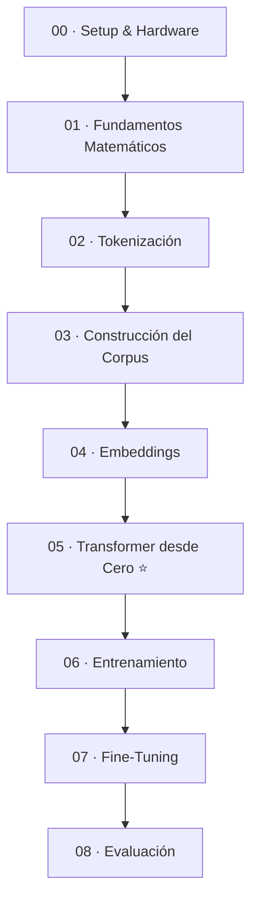

# Notebooks — LLM Lab (Etapa 1)

Nueve notebooks **educativos** (00–08) que recorren el pipeline de un LLM moderno, de la matemática a la evaluación, más un **lanzador** (09) para entrenar tu modelo en Colab/Kaggle.

- **00–08 son autocontenidos:** re-implementan su código en celdas y usan datos de demostración. **No importan** `src/llm_lab` y **no entrenan tu modelo final**: sirven para entender cada pieza.
- **09 no enseña:** ejecuta los scripts del pipeline (`scripts/pretrain.py`, `scripts/sft.py`) sobre el bundle de datos que preparas en el contenedor.

Diferencia completa notebooks vs. pipeline y cómo abrirlos en Docker o Colab: [docs/06 · Guía de ejecución](../docs/06_guia_ejecucion.md).

> Antes de tocar nada, lee la [Guía de Estilo](GUIA_DE_ESTILO.md) (el contrato que cumplen todos los notebooks).

## Mapa de fases

## Índice de notebooks

| # | Notebook | Fase | Contenido | Prerrequisitos | Tiempo (S/L, estimado) |
|---|----------|------|-----------|----------------|--------------|
| 00 | [00_setup_y_hardware](00_setup_y_hardware.ipynb) | Setup | Detección GPU/Colab, seeds, presupuesto de VRAM, perfiles SMALL/LARGE | — | 10 / 10 min |
| 01 | [01_fundamentos_matematicos](01_fundamentos_matematicos.ipynb) | Fundamentos | Historia, álgebra lineal, tensores, backprop (a mano), softmax, cross-entropy, entropía, optimizadores, scaling laws | 00 | 40 / 50 min |
| 02 | [02_tokenizacion](02_tokenizacion.ipynb) | Datos | BPE/WordPiece/SentencePiece/Unigram desde cero, tokenizer propio, ley de Zipf | 01 | 25 / 35 min |
| 03 | [03_construccion_corpus](03_construccion_corpus.ipynb) | Datos | Limpieza, calidad (Gopher/C4), dedup (MinHash/LSH), chunking, topic modeling, weighting, JSONL/Parquet | 02 | 30 / 40 min |
| 04 | [04_embeddings](04_embeddings.ipynb) | Datos | Word2Vec desde cero, GloVe, FastText, contextuales, PCA/t-SNE/UMAP, aritmética vectorial | 01 | 30 / 45 min |
| 05 | [05_transformer_desde_cero](05_transformer_desde_cero.ipynb) ⭐ | Modelo | Self-attention, MHA, RoPE, RMSNorm, residuales, FFN, KV-cache, GQA, Flash Attention, MoE, **MiniGPT completo** | 01, 02 | 45 / 90 min |
| 06 | [06_entrenamiento](06_entrenamiento.ipynb) | Modelo | Loop industrial, AdamW/Lion, mixed precision, grad accumulation, schedulers, checkpointing, scaling laws en vivo, monitoreo GPU | 05 | 40 / 90 min |
| 07 | [07_finetuning](07_finetuning.ipynb) | Especialización | SFT con masking, **LoRA desde cero**, PEFT, QLoRA, chat templates, RLHF y **DPO derivado** | 05, 06 | 40 / 60 min |
| 08 | [08_evaluacion](08_evaluacion.ipynb) | Especialización | Perplexity, BLEU/ROUGE/BERTScore, alucinaciones, toxicidad, sesgo (WEAT), robustez, **benchmark propio** | 01, 06, 07 | 35 / 45 min |
| 09 | [09_entrenamiento_colab_kaggle](09_entrenamiento_colab_kaggle.ipynb) | Lanzador | Pre-entrenamiento + SFT de **tu** modelo con el pipeline, reanudable (Colab/Kaggle) | bundle de datos (`make bundle`) | ~2 h en T4 (estimado) |

⭐ = notebook central del laboratorio.

## Rutas de aprendizaje sugeridas

- **Ruta completa (recomendada):** 00 → 01 → 02 → 03 → 04 → 05 → 06 → 07 → 08. El orden natural; cada fase apoya la siguiente.
- **Ruta rápida (entender el entrenamiento):** 00 → 05 → 06 → 08. Para entrenar tu modelo de verdad, usa el pipeline (docs/06).
- **Ruta solo-arquitectura:** 00 → 01 (§4–9) → 05. Para entender a fondo *cómo funciona* un transformer sin el pipeline de datos.
- **Ruta de datos:** 00 → 02 → 03 → 04. Para el lado de ingeniería de datos / corpus.

## Convenciones (resumen de la guía de estilo)

- **Idioma:** prosa y comentarios en español; identificadores de código en inglés.
- **Shapes:** todo tensor lleva su shape como comentario — convención `B` (batch), `T` (tiempo/secuencia), `C` (`d_model`).
- **Desde cero primero:** implementar en NumPy/PyTorch puro → verificar con `torch.allclose` contra la referencia → luego usar la librería.
- **Matemática:** LaTeX en markdown, con derivación + ejemplo numérico + código + visualización.
- **Reproducibilidad:** `SEED = 42` fijada en cada notebook (Python/NumPy/Torch/CUDA).
- **Autocontenido:** cada notebook corre en Colab o en el contenedor sin el resto del repo. El paquete [`src/llm_lab`](../src/llm_lab/) es la versión limpia y testeada del mismo código, usada por el pipeline.

## Modos SMALL / LARGE (didácticos)

Cada notebook detecta el hardware en su celda de setup y elige perfil (forzable con `PROFILE = "small" | "large"`).
Son tamaños de **demostración**, distintos de los perfiles `tiny`/`small`/`large` del pipeline:

| | SMALL (CPU / T4) | LARGE (GPU ≥ 20–24 GB) |
|---|---|---|
| Modelo (notebooks 00/05) | d_model 256 · 4 capas · ~5 M parámetros | d_model 768 · 12 capas · ~110 M (≈85 M sin embeddings) |
| Vocabulario | 8 000 | 32 000 |
| Contexto | 256 tokens | 1024 tokens |
| Precisión | fp16 en T4 · fp32 en CPU | bf16 |

Algunos notebooks (p. ej. 06) usan modelos aún más chicos para que el entrenamiento de demo termine en minutos.

## Dónde abrirlos

- **Contenedor:** `make jupyter` → http://localhost:8888 (CPU, perfil SMALL).
- **Colab:** sube el `.ipynb`, activa GPU T4, *Ejecutar todo*.

Límites de Colab y presupuestos de VRAM: [`docs/05_colab_y_hardware.md`](../docs/05_colab_y_hardware.md).
